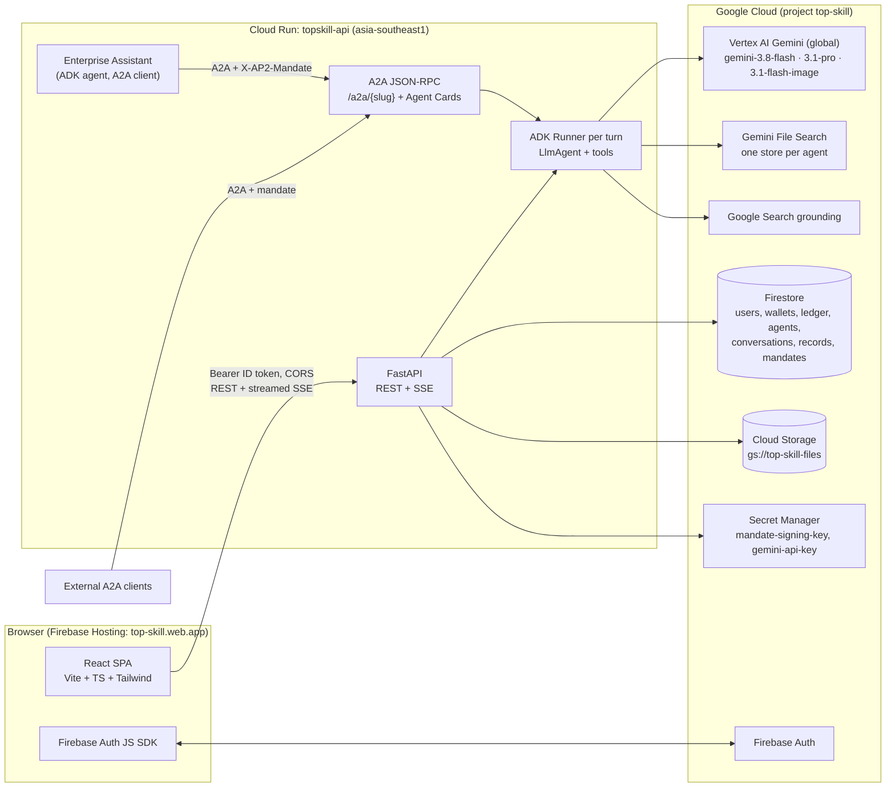

# TopSkill

Turn any expert's skill into a paid AI agent in 60 seconds — usable by people on the web and by other AI agents over A2A, with grounded answers and per-call revenue sharing.

Built for the Google Cloud AI Builder Cup 2026 (theme: Future of Work & Enterprise Productivity) on Gemini, Agent Development Kit, Cloud Run, Firestore and Firebase.

- Web app: https://top-skill.web.app
- API: https://topskill-api-920441209758.asia-southeast1.run.app (`/health`, Agent Cards at `/a2a/{slug}/.well-known/agent-card.json`)
- Implementation spec: [`docs/SPEC.md`](docs/SPEC.md) · E2E checklist: [`docs/E2E.md`](docs/E2E.md) · Demo script: [`docs/DEMO.md`](docs/DEMO.md) · Calling an agent over A2A: [`docs/A2A.md`](docs/A2A.md)

## What it does

1. A creator drops a `SKILL.md` (plus reference files and optional knowledge documents). Gemini drafts the whole agent listing with structured output and can paint an avatar.
   No skill at hand? On `/studio/new`, **Try with a sample skill** loads a career-coach skill folder and a short coaching guide PDF (served from [`web/public/samples/`](web/public/samples/)); agents built from it start unlisted.
2. The creator publishes. The agent gets a public page (`/a/{slug}`) and an A2A endpoint with an Agent Card.
3. Visitors chat on the web. Answers stream over SSE and cite knowledge documents (with page numbers) and Google Search sources. While chatting, the agent fills a structured record the creator can export as CSV.
4. Other AI agents call the agent over A2A, paying per call with a signed, budget-limited intent mandate. Failed calls are not charged.
5. Every paid round or call debits the payer and credits the creator a revenue share (80% by default) in one Firestore transaction.

## Architecture



- **One Cloud Run service** (`topskill-api`, min = max = 1 instance, CPU always allocated, 3600 s timeout for SSE). The browser calls Cloud Run directly; Firebase Hosting serves only static files (Hosting rewrites buffer SSE).
- **Stateless chat**: each turn builds an ADK `LlmAgent` from Firestore config and replays our own message history; Firestore is the source of truth.
- **Knowledge** = Gemini File Search (one store per agent) queried by our own `search_knowledge` tool, which keeps page-level citations. A local term-frequency backend is used in dev/test and as a fallback.
- **Web grounding** = the built-in `google_search` tool.
- **Billing** settles at the end of a turn in one Firestore transaction together with the persisted messages ("persisted ⇒ billed"); failed or interrupted turns are never charged.
- **A2A** calls carry a platform-issued Ed25519 JWS mandate (per-call max, total budget, expiry); public keys at `/.well-known/jwks.json`.

### Google AI in the code

| Piece | What it does | Code |
|---|---|---|
| Gemini on Vertex AI (`gemini-3.8-flash`, fallbacks per call) | Chat turns, record extraction, the Enterprise Assistant | `backend/topskill/gemini.py`, `backend/topskill/config.py` |
| Agent Development Kit | One `LlmAgent` per turn with function tools plus built-in `google_search`; ADK sessions for A2A | `backend/topskill/chat/agent_factory.py`, `backend/topskill/chat/runtime.py` |
| Structured output (`gemini-3.1-pro-preview` for the pro draft) | Drafts the whole agent listing from a `SKILL.md` | `backend/topskill/agents/draft.py` |
| Image generation (`gemini-3.1-flash-image`) | Agent avatars | `backend/topskill/agents/avatar.py` |
| Gemini File Search | One store per agent; our `search_knowledge` tool keeps page-level citations | `backend/topskill/knowledge/file_search.py`, `backend/topskill/knowledge/tool.py` |
| Google Search grounding | Web sources and the search entry point shown under answers | `backend/topskill/chat/agent_factory.py`, `backend/topskill/chat/events.py` |
| A2A v1.0 (+ v0.3 compat) | Agent Cards, JSON-RPC endpoint, Ed25519 JWS intent mandates | `backend/topskill/a2a/` |

## Scaling

TopSkill runs on **one Cloud Run instance today** (deliberately: in-process locks, abort registry and A2A task store are then correct without extra infrastructure). It is **designed to scale out** as follows; none of this is implemented in this round.

| In-process piece today | Multi-instance replacement |
|---|---|
| Per-conversation turn lock | Firestore lease doc `turn_locks/{conversation_id}` taken with `create()` + `expires_at`, released with a precondition delete, stale leases expire via TTL |
| Abort registry (`asyncio.Event`) | Firestore doc `turn_aborts/{conversation_id}__{turn_id}` polled by the producer, so abort works from any instance |
| A2A in-memory task store | Firestore-backed task store (`a2a_tasks/{task_id}`), so `GetTask` / `CancelTask` work across instances |
| A2A stack cache | Stays per instance (rebuildable cache keyed by agent version and knowledge revision) |
| Creator wallet hot spot (one wallet doc written on every paid round) | Creator income credited to N sharded docs with `Increment` and no read inside the settlement transaction; balance = sum of shards |
| Process-wide concurrent-turn semaphore | Per-instance limit × max instances; Cloud Run `--concurrency` caps streams per instance |
| Background tasks | Cloud Tasks queue for ingestion and extraction (handlers are already idempotent) |
| Deployment | `--min-instances 1 --max-instances N`; no session affinity needed once the above is in place |

## Quick start (local)

Prerequisites: Python 3.12 + [uv](https://docs.astral.sh/uv/), Node 22, Java ≥ 21 (for the Firebase emulators), `firebase-tools` 15, `gcloud` with Application Default Credentials (`gcloud auth application-default login`) for Gemini on Vertex AI.

```bash
# Backend dependencies and dev settings
cd backend && uv sync && cp .env.example .env && cd ..
# Web dependencies
cd web && npm ci && cd ..

# Emulators (demo-topskill) + backend :8000 + web :5173; Ctrl-C stops everything
deploy/scripts/dev_up.sh
```

Open http://localhost:5173 and use **Developer login** (dev auth bypass). Ports can be overridden (`FS_PORT`, `AUTH_PORT`, `API_PORT`, `WEB_PORT`, …); see the header of `deploy/scripts/dev_up.sh`.

Tests:

```bash
# Backend: ruff + pytest against private emulator ports (see docs/E2E.md)
cd backend
uv run ruff check . && uv run ruff format --check .
../deploy/scripts/emu_exec.sh 8180 9199 4480 4580 -- uv run pytest -m "not live"
uv run pytest -m live          # real Gemini calls, manual only

# Web
cd web && npm run typecheck && npm run lint && npm test && npm run build
```

## Deploy (production, project `top-skill`)

Deploys run from a laptop with the owner's gcloud / firebase login (CI only runs tests).

```bash
deploy/scripts/provision.sh --yes        # idempotent: APIs, Artifact Registry, bucket, service accounts, IAM, secret
firebase deploy --only firestore:rules,firestore:indexes --project top-skill
deploy/scripts/deploy_backend.sh --smoke # Cloud Build -> Cloud Run topskill-api, revision + /health check, smoke test
deploy/scripts/deploy_web.sh             # production build -> Firebase Hosting
deploy/scripts/smoke_prod.sh             # CORS, auth, every list endpoint × filter combination; fails on any 5xx
```

Cloud Run's front end reserves URL paths ending in `z`: `/healthz` answers a Google 404 from outside and is
used only by the in-container startup probe. Check liveness from outside with `/health` (or `/api/public/meta`).
Until every domain router is merged, run the smoke test with `--allow-missing` (404 = "absent", 5xx still fails).

| Piece | Where |
|---|---|
| Image | `asia-southeast1-docker.pkg.dev/top-skill/topskill/api:<git sha>` (`deploy/backend.Dockerfile`, `deploy/cloudbuild.yaml`) |
| Runtime identity | `topskill-api@top-skill.iam.gserviceaccount.com` |
| Non-secret env | `deploy/env/prod.env.yaml` |
| Secrets | Secret Manager `mandate-signing-key`, `gemini-api-key` (injected with `--set-secrets`) |
| Firestore | `firestore.rules` (deny all client access), `firestore.indexes.json` |

## Repository layout

```
backend/   FastAPI + ADK service (package topskill)
web/       React SPA
deploy/    Dockerfile, Cloud Build config, prod env, scripts
docs/      SPEC.md, E2E.md, DEMO.md
```

## License

PolyForm Noncommercial 1.0.0, see [LICENSE](LICENSE).
